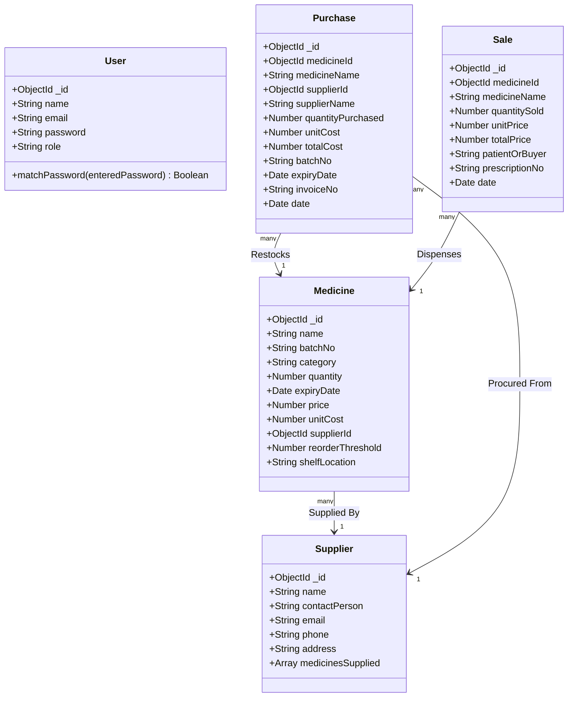
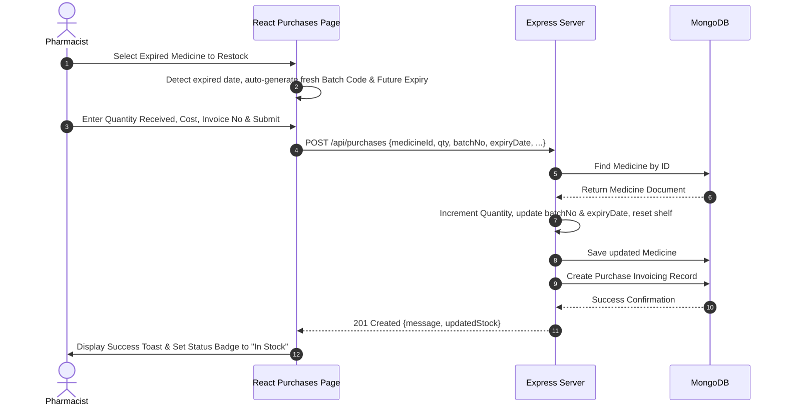

# DOSEFLOW: INTELLIGENT PHARMACY INVENTORY & CLINICAL DISPENSING MANAGEMENT SYSTEM

**A PROJECT REPORT**

*Submitted by*  
**N.Vasanth (310624205295)**

*in partial fulfillment for the award of the Degree of*  
**BACHELOR OF ENGINEERING**  
*in*  
**DEPARTMENT OF INFORMATION TECHNOLOGY**

<br>

**EASWARI ENGINEERING COLLEGE**  
*(AN AUTONOMOUS INSTITUTION) – AFFILIATED TO ANNA UNIVERSITY, CHENNAI*  
**OCTOBER 2026**

---

## EASWARI ENGINEERING COLLEGE
### BONAFIDE CERTIFICATE

Certified that this mini project report titled **“DOSEFLOW: INTELLIGENT PHARMACY INVENTORY & CLINICAL DISPENSING MANAGEMENT SYSTEM”** is the Bonafide work of **“N.Vasanth (310624205295)”**, who carried out the project work under my supervision.

<br><br>
_________________________________ &emsp;&emsp;&emsp;&emsp;&emsp;&emsp;&emsp;&emsp; _________________________________  
**HEAD OF THE DEPARTMENT** &emsp;&emsp;&emsp;&emsp;&emsp;&emsp;&emsp;&emsp;&emsp;&emsp;&emsp;&emsp;&emsp; **SUPERVISOR**  
Department of Information Technology &emsp;&emsp;&emsp;&emsp;&emsp; Department of Information Technology  
Easwari Engineering College, Chennai &emsp;&emsp;&emsp;&emsp;&emsp;&emsp;&emsp;&emsp;&emsp; Easwari Engineering College, Chennai  

---

## EASWARI ENGINEERING COLLEGE
### Certificate of Viva-voce-Examination

This is to certify that the Viva Voce Examination of the Project Work entitled **“DOSEFLOW: INTELLIGENT PHARMACY INVENTORY & CLINICAL DISPENSING MANAGEMENT SYSTEM”** submitted by **[Mr./Ms. N.Vasanth] (Reg. No. 310624205295)** in partial fulfillment of the requirements for the award of the degree of **Bachelor of Engineering in Information Technology** was conducted on **_________________ (Date)** in the Department of Information Technology, Easwari Engineering College, Ramapuram – Chennai.

<br><br>
**Internal Examiner** &emsp;&emsp;&emsp;&emsp;&emsp;&emsp;&emsp;&emsp;&emsp;&emsp;&emsp;&emsp;&emsp;&emsp;&emsp;&emsp;&emsp;&emsp; **External Examiner**  
Name: _______________________________ &emsp;&emsp;&emsp;&emsp;&emsp;&emsp;&emsp;&emsp; Name: _______________________________  
Designation: ________________________ &emsp;&emsp;&emsp;&emsp;&emsp;&emsp;&emsp;&emsp; Designation: ________________________  
Address: ____________________________ &emsp;&emsp;&emsp;&emsp;&emsp;&emsp;&emsp;&emsp; Address: ____________________________  
Date: _______________________________ &emsp;&emsp;&emsp;&emsp;&emsp;&emsp;&emsp;&emsp; Date: _______________________________  

---

## ABSTRACT

In modern healthcare operations, hospital pharmacies and clinical dispensaries face severe challenges stemming from manual stock records, stockouts of life-saving medicines, inadvertent dispensing of expired pharmaceutical batches, and untracked supplier replenishment. **DoseFlow** is an intelligent, full-stack pharmaceutical inventory and clinical dispensing management system engineered to modernize hospital pharmacy operations.

Built using the MERN stack (MongoDB, Express.js, React.js, Node.js), DoseFlow provides an automated, safety-first platform that enforces clinical protocols. The system features:
1. **Dynamic Restock Suggestion Engine**: Uses past 30-day burn velocities, supplier lead times, and safety buffers to calculate replenishment requirements.
2. **Batch Expiry Monitoring & Automated Quarantine Protocols**: Preemptively flags expiring lots and enforces strict point-of-sale blocking for expired batches.
3. **Decommissioning & Shelf Removal**: Provides an auditable mechanism to decommission expired stock from physical shelves into Quarantine Disposal before batch renewals.
4. **End-to-End Procurement & Dispensing Workflows**: Manages supplier relationships, purchase invoice recording, barcode/batch logging, and live outpatient sales terminals.
5. **Role-Based Access Control (RBAC)**: Guarantees that only authorized clinical personnel can perform inventory updates, audit trails, and administrative reconciliations.

The resulting web application minimizes stockouts, eliminates dispensing errors, reduces wastage from expired medications, and optimizes procurement expenditure.

---

## ACKNOWLEDGEMENT

We express our sincere gratitude to the Principal **Dr. P. Deiva Sundari** and the Management of our college for providing us with the opportunity to carry out this project work.

We convey our heartfelt thanks to the Head of the Department, **Department of Computer Science and Engineering**, for the continuous encouragement and support.

We are extremely thankful to our Project Guide, **[Guide Name]**, Department of Computer Science and Engineering for valuable guidance, suggestions, and motivation throughout the completion of this project.

We would also like to extend our gratitude to all the faculty members of the Department of Computer Science and Engineering for their support.

Finally, we thank our parents and friends for their constant encouragement and help during the course of this project.

---

## TABLE OF CONTENTS

| CHAPTER NO. | TITLE | PAGE NO. |
| :---: | :--- | :---: |
| | **ABSTRACT** | iv |
| | **LIST OF FIGURES** | vii |
| **1** | **INTRODUCTION** | 1 |
| | 1.1 Overview | 1 |
| | 1.2 Problem Definition | 2 |
| | 1.3 Objective | 3 |
| | 1.4 Scope of the Project | 3 |
| | 1.5 Motivation | 4 |
| **2** | **RELATED WORK** | 5 |
| | 2.1 Literature Review | 5 |
| | 2.2 Existing System | 6 |
| | 2.3 Proposed System | 7 |
| **3** | **SYSTEM ANALYSIS** | 9 |
| | 3.1 System Requirements | 9 |
| | 3.2 Software and Hardware Requirements | 10 |
| **4** | **SYSTEM DESIGN** | 12 |
| | 4.1 System Architecture | 12 |
| | 4.2 Module Description | 14 |
| | 4.3 Class Diagram | 16 |
| | 4.4 Sequence Diagram | 17 |
| **5** | **IMPLEMENTATION** | 18 |
| | 5.1 Implementation Overview | 18 |
| | 5.2 Key Functions (Code Explanation) | 19 |
| **6** | **CONCLUSION & FUTURE WORK** | 24 |
| | 6.1 Conclusion | 24 |
| | 6.2 Future Enhancements | 24 |
| | **APPENDIX - SOURCE CODE** | 26 |
| | **SCREENSHOTS OF THE PROJECT** | 38 |
| | **REFERENCES** | 41 |

---

# CHAPTER 1: INTRODUCTION

### 1.1 OVERVIEW
In institutional healthcare and hospital administration, pharmacy logistics play a mission-critical role. A breakdown in pharmaceutical inventory directly impacts patient care, leading to treatment delays, clinical complications, or catastrophic dispensing errors. **DoseFlow** is designed as a web-based clinical pharmacy management system that bridges hospital procurement, inventory control, and patient dispensing into a unified ecosystem.

By leveraging real-time telemetry, automated stock calculation algorithms, and strict expiration date enforcement, DoseFlow equips pharmacists and clinical administrators with high-precision inventory tracking.

### 1.2 PROBLEM DEFINITION
Traditional pharmacy workflows suffer from major vulnerabilities:
1. **Manual Record Inefficiencies**: Reliance on physical registers or disconnected spreadsheets results in human error, delayed auditing, and inventory discrepancy.
2. **Expired Medication Risks**: Dispensing medications past their expiration date poses severe medical hazards and legal liabilities for healthcare providers.
3. **Reactive Restocking**: Pharmacists frequently discover stockouts only when dispensing medications to patients, leading to emergency supply runs and inflated procurement costs.
4. **Lack of Shelf Auditing**: Expired batches often remain on active shelves, mixing with fresh stock.
5. **Untracked Supplier Accountability**: Disconnected purchase orders and invoices lead to unaccounted expenditures and poor vendor performance tracking.

### 1.3 OBJECTIVE
The core objectives of the DoseFlow system are:
* To engineer a centralized, real-time inventory management platform for pharmaceutical items.
* To implement a **Smart Restock Suggestion Engine** that automatically predicts inventory deficits based on daily burn rate and supplier lead time.
* To enforce **automated quarantine protocols** that prevent the point-of-sale dispensing of expired batches.
* To facilitate a dedicated **Decommissioning Workflow** allowing staff to remove expired stock from physical racks into quarantine before logging new shipments.
* To provide robust **Role-Based Access Control (RBAC)** and audit-ready reporting.

### 1.4 SCOPE OF THE PROJECT
* **In-Scope**:
  * Complete lifecycle tracking of medications (Name, Batch Code, Category, Price, Cost, Expiry Date, Shelf Location).
  * Automated low-stock and near-expiry alerts with multi-tiered urgency scoring.
  * Point-of-Sale (POS) terminal with real-time stock deduction, inventory sufficiency checks, and invoice generation.
  * Restock recording with batch renewal, new expiry date capture, and supplier linking.
  * Shelf decommissioning and disposal logging.
  * Analytical dashboard with expenditure metrics, revenue metrics, and sales velocity charts.
* **Out-of-Scope (Future Phase)**:
  * Direct payment gateway integration (cash/credit currently recorded internally).
  * IoT temperature sensor integration for cold-chain storage.

### 1.5 MOTIVATION
In clinical settings, a stockout is not just a commercial inconvenience—it can be life-threatening. Similarly, accidentally dispensing an expired antibiotic can cause severe clinical consequences. The primary motivation behind DoseFlow is to apply modern software engineering principles to guarantee patient safety, eliminate administrative overhead, and automate inventory decisions using mathematical models.

---

# CHAPTER 2: RELATED WORK

### 2.1 LITERATURE REVIEW
Modern inventory literature highlights the criticality of the **Economic Order Quantity (EOQ)** and **Reorder Point (ROP)** models in healthcare logistics. Studies demonstrate that hospitals maintaining static reorder buffers often face either overstocking (leading to capital tie-up and drug spoilage) or understocking during disease surges. Modern research advocates for dynamic velocity-based thresholding where past consumption directly informs replenishment horizons.

Furthermore, healthcare compliance frameworks emphasize **Good Pharmacy Practice (GPP)**, requiring physical and logical quarantine of degraded or expired medications to prevent accidental distribution.

### 2.2 EXISTING SYSTEM
Traditional and legacy pharmacy systems have several fundamental drawbacks:
* **Static Thresholds**: Reorder alerts rely on fixed numbers (e.g., alert when stock < 10) without considering seasonal consumption or dispensing frequency.
* **No Expiry Restock Validation**: When restocking existing records, legacy systems simply increment counts without updating the expiration date, causing stock to permanently register as expired.
* **Lack of Quarantine Protocols**: Expired stock remains mixed in the general inventory pool until discovered manually during annual audits.
* **Poor User Experience**: Monolithic desktop applications built with outdated interfaces, lacking responsiveness, search indexing, and real-time visual badges.

### 2.3 PROPOSED SYSTEM
DoseFlow introduces significant innovations over existing architectures:
* **Dynamic Burn-Velocity Suggestion Engine**: Continuously evaluates the last 30 days of sales data, applies safety stock buffers, and factors in supplier lead times to suggest exact order quantities.
* **Batch Renewal upon Restock**: Captures new shipment batch codes and valid future expiry dates during inbound logistics, restoring items to "In Stock" status.
* **One-Click Shelf Decommissioning**: Enables staff to zero out expired stock and log removal to Quarantine Disposal.
* **Interactive Responsive Interface**: Built with modern CSS design tokens, glassmorphism cards, and real-time search indexing.
* **RESTful Micro-Architecture**: Modular controllers and routes decoupled from the React client for high maintainability.

---

# CHAPTER 3: SYSTEM ANALYSIS

### 3.1 SYSTEM REQUIREMENTS
The system satisfies both functional and non-functional requirements:

#### Functional Requirements:
1. **User Authentication & RBAC**: Secure JWT-based authentication supporting Admin and Staff roles.
2. **Inventory Management**: CRUD operations for medicines with fields for batch code, expiry date, category, shelf location, unit cost, and price.
3. **Smart Reorder Alerts**: Calculation of consumption velocity, near-expiry warnings, and automated restock suggestions.
4. **Sales & Dispense Terminal**: Live cart, stock availability validation, expiry lockouts, and invoice generation.
5. **Procurement & Invoicing**: Recording supplier restocks with batch code and expiry updates.
6. **Shelf Quarantine**: Ability to decommission expired units off active racks into disposal.

#### Non-Functional Requirements:
* **Performance**: Sub-200ms response time for API queries via indexed MongoDB lookups.
* **Reliability & Data Integrity**: Atomic transactions for stock decrement and increment operations.
* **Security**: Password hashing using `bcryptjs`, HTTP-only/Bearer token authorization, sanitization against NoSQL injection.
* **Usability**: Accessible dark/light visual hierarchy with clear clinical status indicators.

### 3.2 SOFTWARE AND HARDWARE REQUIREMENTS

#### Software Requirements:
* **Operating System**: Windows 10/11, Linux (Ubuntu 20.04+), or macOS
* **Runtime Environment**: Node.js (v18.x or v20.x LTS)
* **Database Management System**: MongoDB (v6.x or Atlas Cloud Cluster)
* **Frontend Framework**: React.js 19 with Vite bundler
* **Styling**: Vanilla Modern CSS with CSS custom properties
* **API Testing Tool**: Postman / Thunder Client
* **Version Control**: Git & GitHub

#### Hardware Requirements:
* **Processor**: Intel Core i3 / AMD Ryzen 3 or higher
* **RAM**: Minimum 4 GB (8 GB recommended)
* **Storage**: Minimum 500 MB free hard disk space for code and database
* **Network**: Broadband Internet connection for API and remote database access

---

# CHAPTER 4: SYSTEM DESIGN

### 4.1 SYSTEM ARCHITECTURE

DoseFlow follows a 3-tier client-server architecture:

```
+-------------------------------------------------------------------+
|                        PRESENTATION TIER                          |
|   React.js 19 SPA (Vite) + Lucide Icons + Modern CSS Dashboard   |
|   [Dashboard]  [Inventory]  [Sales/POS]  [Purchases]  [Alerts]    |
+---------------------------------+---------------------------------+
                                  | HTTP / JSON Requests (Axios)
                                  v
+-------------------------------------------------------------------+
|                        APPLICATION TIER                           |
|       Node.js & Express.js REST API Server (Port: 5000)           |
|  +-------------------+  +-------------------+  +----------------+ |
|  | Auth Middleware   |  | Medicine Service  |  | Reorder Engine | |
|  +-------------------+  +-------------------+  +----------------+ |
|  | Purchase Service  |  | Sales Controller  |  | Alert Service  | |
|  +-------------------+  +-------------------+  +----------------+ |
+---------------------------------+---------------------------------+
                                  | Mongoose ODM
                                  v
+-------------------------------------------------------------------+
|                          DATA TIER                                |
|             MongoDB Document Database (Collections)              |
|     [Users]     [Medicines]     [Suppliers]     [Purchases/Sales] |
+-------------------------------------------------------------------+
```

### 4.2 MODULE DESCRIPTION

1. **Authentication & User Management Module**:
   Handles user sign-up, login, password encryption using BCrypt, JWT token creation, and role-based route protection (`Admin` vs `Staff`).
2. **Inventory & Shelf Tracking Module**:
   Provides inventory querying with regex search, category filtering, shelf location tracking, stock editing, and batch deletion.
3. **Smart Reorder & Suggestion Engine**:
   Analyzes 30-day historical sales, applies lead time and safety buffers, and generates purchase suggestions.
4. **Safety Alerts & Expiry Quarantine Module**:
   Monitors days-until-expiry and reorder thresholds. Provides the **"Remove from Shelf"** decommissioning mechanism.
5. **Procurement & Restock Module**:
   Logs inbound supplier deliveries, increments stock, records unit cost, updates batch numbers, and extends expiration dates.
6. **Clinical Dispense & Sales Terminal Module**:
   Handles outpatient and ward sales, validates against expired batches, deducts stock, and records patient prescription details.

### 4.3 CLASS DIAGRAM



### 4.4 SEQUENCE DIAGRAM (RESTOCK & EXPIRY RENEWAL)



---

# CHAPTER 5: IMPLEMENTATION

### 5.1 IMPLEMENTATION OVERVIEW
The implementation is organized into a modular backend and component-driven frontend:
* **Backend**: Developed with ES6+ Node.js and Express.js. Implements asynchronous controller functions, Mongoose schema modeling, express-validator sanitization pipelines, and centralized error handling middleware.
* **Frontend**: Built using React 19 and Vite. Utilizes React Context (`InventoryContext`) for synchronized global refresh triggers and toast notifications. Employs modular subcomponents like `StatusBadge`, `Modal`, `StatsCard`, and `Pagination`.

### 5.2 KEY FUNCTIONS (CODE EXPLANATION)

#### 1. Dynamic Restock Suggestion Algorithm (`server/services/reorderService.js`)
Calculates the dynamic replenishment point based on past 30-day velocity:
```javascript
export const getReorderSuggestions = async () => {
  const thirtyDaysAgo = new Date();
  thirtyDaysAgo.setDate(thirtyDaysAgo.getDate() - 30);

  // 1. Compute 30-day sales velocity per medicine
  const recentSales = await Sale.aggregate([
    { $match: { date: { $gte: thirtyDaysAgo } } },
    { $group: { _id: '$medicineId', totalSold: { $sum: '$quantitySold' } } }
  ]);

  // 2. Iterate medicines & calculate target planning horizon
  for (const med of medicines) {
    const soldIn30Days = salesMap.get(med._id.toString()) || 0;
    const dailyRate = Math.max(soldIn30Days / 30, (med.reorderThreshold / 30) * 0.4);

    // Planning Horizon = 7 days lead time + 14 days safety stock
    const targetInventoryLevel = Math.ceil(dailyRate * 21);

    if (effectiveStock <= med.reorderThreshold || effectiveStock < targetInventoryLevel) {
      const neededQuantity = Math.max(
        targetInventoryLevel - effectiveStock,
        (med.reorderThreshold * 2) - effectiveStock,
        25 // minimum order batch
      );
      // Push suggestion with urgency calculation...
    }
  }
};
```

#### 2. Restock with Batch Renewal (`server/controllers/purchaseController.js`)
Ensures that restocked medicines update their expiration dates and clear quarantine locations:
```javascript
export const createPurchase = async (req, res, next) => {
  const { medicineId, supplierId, quantityPurchased, unitCost, batchNo, expiryDate } = req.body;
  const medicine = await Medicine.findById(medicineId);

  // Increment stock
  medicine.quantity += Number(quantityPurchased);
  if (batchNo) medicine.batchNo = batchNo;
  if (expiryDate) medicine.expiryDate = new Date(expiryDate);
  if (medicine.shelfLocation?.includes('Quarantine')) {
    medicine.shelfLocation = 'Main Storage'; // Restored to active shelf
  }
  await medicine.save();

  // Create Purchase record...
};
```

#### 3. Decommissioning Expired Shelf Stock (`server/controllers/medicineController.js`)
Zeros out degraded stock and updates the location to quarantine disposal:
```javascript
export const removeFromShelf = async (req, res, next) => {
  const medicine = await Medicine.findById(req.params.id);
  const previousQty = medicine.quantity;
  
  medicine.quantity = 0;
  medicine.shelfLocation = 'Quarantine Bay (Disposed)';
  await medicine.save();

  res.status(200).json({
    success: true,
    message: `Decommissioned ${previousQty} expired unit(s) of ${medicine.name} to Quarantine.`
  });
};
```

#### 4. Expiry Safety Lockout during Dispense (`server/controllers/saleController.js`)
Prevents medical hazards by blocking expired medication dispense:
```javascript
// Check expiry before authorizing sale
const now = new Date();
if (new Date(medicine.expiryDate) < now) {
  return res.status(400).json({
    success: false,
    message: `Cannot sell expired medicine (${medicine.name}). Expired on ${new Date(medicine.expiryDate).toLocaleDateString()}.`
  });
}
```

---

# CHAPTER 6: CONCLUSION & FUTURE WORK

### 6.1 CONCLUSION
**DoseFlow** delivers a production-grade, clinically sound pharmacy inventory and dispensing management system. By tackling the limitations of legacy tools, the project introduces:
* Automated, mathematical stock suggestions that prevent costly stockouts.
* Rigorous expiration date enforcement that blocks dispensing of hazardous batches.
* Standardized shelf decommissioning workflows that prevent expired products from remaining in active storage.
* Streamlined supplier restocking with automatic lot code and expiry date renewals.

The software significantly enhances operational efficiency, reduces financial waste from expired pharmaceuticals, and upholds high patient safety standards.

### 6.2 FUTURE ENHANCEMENTS
* **GS1 DataMatrix & 2D Barcode Scanning**: Integration with hardware barcode scanners to instantly decode batch numbers and expiry dates during receipt and dispensing.
* **Automated Supplier EDI / Email Invoicing**: Auto-generating and transmitting purchase orders via email or EDI when stock breaches critical thresholds.
* **Predictive AI / Machine Learning Forecasting**: Implementing ARIMA or LSTM neural networks to forecast seasonal drug demand (e.g., flu season antivirals).
* **Multi-Branch & Central Hospital Warehouse Hierarchy**: Enabling multi-tenant distribution where hospital satellite pharmacies request internal transfers from a central repository.

---

# APPENDIX: SOURCE CODE

### 1. Project Directory Structure
```
DoseFlow/
├── server/
│   ├── config/
│   │   └── db.js
│   ├── controllers/
│   │   ├── authController.js
│   │   ├── dashboardController.js
│   │   ├── medicineController.js
│   │   ├── purchaseController.js
│   │   ├── saleController.js
│   │   └── supplierController.js
│   ├── middleware/
│   │   ├── auth.js
│   │   ├── errorHandler.js
│   │   └── validate.js
│   ├── models/
│   │   ├── Medicine.js
│   │   ├── Purchase.js
│   │   ├── Sale.js
│   │   ├── Supplier.js
│   │   └── User.js
│   ├── routes/
│   │   ├── authRoutes.js
│   │   ├── dashboardRoutes.js
│   │   ├── medicineRoutes.js
│   │   ├── purchaseRoutes.js
│   │   ├── saleRoutes.js
│   │   └── supplierRoutes.js
│   ├── services/
│   │   ├── alertService.js
│   │   └── reorderService.js
│   ├── .env
│   ├── package.json
│   └── server.js
│
└── client/
    ├── src/
    │   ├── components/
    │   │   ├── Common/ (Modal, Pagination, StatsCard, StatusBadge)
    │   │   └── Layout/ (Navbar, Sidebar)
    │   ├── context/
    │   │   ├── AuthContext.jsx
    │   │   └── InventoryContext.jsx
    │   ├── pages/
    │   │   ├── Alerts.jsx
    │   │   ├── Dashboard.jsx
    │   │   ├── Inventory.jsx
    │   │   ├── Login.jsx
    │   │   ├── Purchases.jsx
    │   │   ├── Register.jsx
    │   │   ├── Sales.jsx
    │   │   ├── Staff.jsx
    │   │   └── Suppliers.jsx
    │   ├── services/
    │   │   ├── api.js
    │   │   ├── authService.js
    │   │   ├── medicineService.js
    │   │   ├── purchaseService.js
    │   │   └── saleService.js
    │   ├── App.jsx
    │   ├── index.css
    │   └── main.jsx
    ├── package.json
    └── vite.config.js
```

### 2. Backend Package Installation Commands
```bash
# Navigate to server directory
cd server

# Initialize and install dependencies
npm install express mongoose dotenv cors bcryptjs jsonwebtoken express-validator morgan

# Install development dependencies
npm install -D nodemon
```

### 3. Database Connection (`server/config/db.js`)
```javascript
import mongoose from 'mongoose';

const connectDB = async () => {
  try {
    const conn = await mongoose.connect(process.env.MONGO_URI, {
      useNewUrlParser: true,
      useUnifiedTopology: true
    });
    console.log(`[MongoDB Connected]: ${conn.connection.host}`);
  } catch (error) {
    console.error(`[Database Error]: ${error.message}`);
    process.exit(1);
  }
};

export default connectDB;
```

### 4. Environment Variables Configuration (`server/.env`)
```env
PORT=5000
NODE_ENV=development
MONGO_URI=mongodb+srv://<username>:<password>@cluster0.mongodb.net/doseflow?retryWrites=true&w=majority
JWT_SECRET=doseflow_super_secret_clinical_jwt_key_2026
JWT_EXPIRE=7d
```

### 5. User Model (`server/models/User.js`)
```javascript
import mongoose from 'mongoose';
import bcrypt from 'bcryptjs';

const userSchema = new mongoose.Schema({
  name: { type: String, required: true, trim: true },
  email: { type: String, required: true, unique: true, lowercase: true, trim: true },
  password: { type: String, required: true, minlength: 6 },
  role: { type: String, enum: ['admin', 'pharmacist'], default: 'pharmacist' }
}, { timestamps: true });

userSchema.pre('save', async function (next) {
  if (!this.isModified('password')) return next();
  const salt = await bcrypt.genSalt(10);
  this.password = await bcrypt.hash(this.password, salt);
});

userSchema.methods.matchPassword = async function (enteredPassword) {
  return await bcrypt.compare(enteredPassword, this.password);
};

export default mongoose.model('User', userSchema);
```

### 6. User Registration & Password Hashing (`server/controllers/authController.js`)
```javascript
export const register = async (req, res, next) => {
  try {
    const { name, email, password, role } = req.body;
    const userExists = await User.findOne({ email });
    if (userExists) {
      return res.status(400).json({ success: false, message: 'Email is already registered' });
    }
    const user = await User.create({ name, email, password, role });
    const token = jwt.sign({ id: user._id, role: user.role }, process.env.JWT_SECRET, {
      expiresIn: process.env.JWT_EXPIRE || '7d'
    });
    res.status(201).json({
      success: true,
      token,
      user: { id: user._id, name: user.name, email: user.email, role: user.role }
    });
  } catch (err) {
    next(err);
  }
};
```

### 7. Login & JWT Generation (`server/controllers/authController.js`)
```javascript
export const login = async (req, res, next) => {
  try {
    const { email, password } = req.body;
    const user = await User.findOne({ email });
    if (!user || !(await user.matchPassword(password))) {
      return res.status(401).json({ success: false, message: 'Invalid email or password' });
    }
    const token = jwt.sign({ id: user._id, role: user.role }, process.env.JWT_SECRET, {
      expiresIn: process.env.JWT_EXPIRE || '7d'
    });
    res.status(200).json({
      success: true,
      token,
      user: { id: user._id, name: user.name, email: user.email, role: user.role }
    });
  } catch (err) {
    next(err);
  }
};
```

### 8. Authentication & Role Authorization Middleware (`server/middleware/auth.js`)
```javascript
import jwt from 'jsonwebtoken';
import User from '../models/User.js';

export const protect = async (req, res, next) => {
  let token;
  if (req.headers.authorization && req.headers.authorization.startsWith('Bearer')) {
    token = req.headers.authorization.split(' ')[1];
  }
  if (!token) {
    return res.status(401).json({ success: false, message: 'Authorization token required' });
  }
  try {
    const decoded = jwt.verify(token, process.env.JWT_SECRET);
    req.user = await User.findById(decoded.id).select('-password');
    next();
  } catch (err) {
    return res.status(401).json({ success: false, message: 'Token invalid or expired' });
  }
};

export const authorize = (...roles) => (req, res, next) => {
  if (!roles.includes(req.user.role)) {
    return res.status(403).json({ success: false, message: 'Access forbidden for your role' });
  }
  next();
};
```

### 9. Create Medicine API (`server/controllers/medicineController.js`)
```javascript
export const createMedicine = async (req, res, next) => {
  try {
    const medicine = await Medicine.create(req.body);
    await Supplier.findByIdAndUpdate(medicine.supplierId, {
      $addToSet: { medicinesSupplied: medicine._id }
    });
    res.status(201).json({ success: true, data: medicine, message: 'Medicine created successfully' });
  } catch (err) {
    next(err);
  }
};
```

### 10. Read / Query Medicines API with Pagination & Filters (`server/controllers/medicineController.js`)
```javascript
export const getMedicines = async (req, res, next) => {
  try {
    const { search, category, status, page = 1, limit = 8 } = req.query;
    let query = {};
    if (search) {
      query.$or = [{ name: { $regex: search, $options: 'i' } }, { batchNo: { $regex: search, $options: 'i' } }];
    }
    if (category && category !== 'All') query.category = category;
    
    const now = new Date();
    if (status === 'low_stock') query.$expr = { $lte: ['$quantity', '$reorderThreshold'] };
    else if (status === 'out_of_stock') query.quantity = 0;
    else if (status === 'expired') query.expiryDate = { $lte: now };
    else if (status === 'in_stock') {
      query.$and = [{ $expr: { $gt: ['$quantity', '$reorderThreshold'] } }, { expiryDate: { $gt: now } }];
    }

    const totalCount = await Medicine.countDocuments(query);
    const medicines = await Medicine.find(query)
      .populate('supplierId', 'name contactPerson email phone')
      .sort({ createdAt: -1 })
      .skip((page - 1) * limit)
      .limit(Number(limit));

    res.status(200).json({ success: true, data: medicines, totalCount, totalPages: Math.ceil(totalCount / limit) });
  } catch (err) {
    next(err);
  }
};
```

### 11. Update Medicine & Shelf Decommission API
```javascript
export const updateMedicine = async (req, res, next) => {
  try {
    const updated = await Medicine.findByIdAndUpdate(req.params.id, req.body, { new: true, runValidators: true });
    res.status(200).json({ success: true, data: updated, message: 'Medicine updated successfully' });
  } catch (err) {
    next(err);
  }
};

export const removeFromShelf = async (req, res, next) => {
  try {
    const medicine = await Medicine.findById(req.params.id);
    const previousQty = medicine.quantity;
    medicine.quantity = 0;
    medicine.shelfLocation = 'Quarantine Bay (Disposed)';
    await medicine.save();
    res.status(200).json({ success: true, data: medicine, message: `Removed ${previousQty} units from shelf.` });
  } catch (err) {
    next(err);
  }
};
```

### 12. Delete Medicine API (`server/controllers/medicineController.js`)
```javascript
export const deleteMedicine = async (req, res, next) => {
  try {
    const medicine = await Medicine.findById(req.params.id);
    if (!medicine) return res.status(404).json({ success: false, message: 'Medicine not found' });
    if (medicine.supplierId) {
      await Supplier.findByIdAndUpdate(medicine.supplierId, { $pull: { medicinesSupplied: medicine._id } });
    }
    await Medicine.findByIdAndDelete(req.params.id);
    res.status(200).json({ success: true, message: 'Medicine deleted successfully' });
  } catch (err) {
    next(err);
  }
};
```

### 13. Express Routing Configuration (`server/routes/medicineRoutes.js`)
```javascript
import express from 'express';
import { getMedicines, getMedicineById, createMedicine, updateMedicine, deleteMedicine, removeFromShelf } from '../controllers/medicineController.js';
import { protect, authorize } from '../middleware/auth.js';

const router = express.Router();
router.use(protect);

router.route('/')
  .get(getMedicines)
  .post(createMedicine);

router.route('/:id')
  .get(getMedicineById)
  .put(updateMedicine)
  .delete(authorize('admin'), deleteMedicine);

router.put('/:id/remove-from-shelf', removeFromShelf);

export default router;
```

### 14. Main Express Server (`server/server.js`)
```javascript
import express from 'express';
import dotenv from 'dotenv';
import cors from 'cors';
import morgan from 'morgan';
import connectDB from './config/db.js';
import authRoutes from './routes/authRoutes.js';
import medicineRoutes from './routes/medicineRoutes.js';
import supplierRoutes from './routes/supplierRoutes.js';
import saleRoutes from './routes/saleRoutes.js';
import purchaseRoutes from './routes/purchaseRoutes.js';
import dashboardRoutes from './routes/dashboardRoutes.js';
import { errorHandler } from './middleware/errorHandler.js';

dotenv.config();
connectDB();

const app = express();
app.use(cors());
app.use(express.json());
if (process.env.NODE_ENV === 'development') app.use(morgan('dev'));

// Route Mounts
app.use('/api/auth', authRoutes);
app.use('/api/medicines', medicineRoutes);
app.use('/api/suppliers', supplierRoutes);
app.use('/api/sales', saleRoutes);
app.use('/api/purchases', purchaseRoutes);
app.use('/api/dashboard', dashboardRoutes);

app.use(errorHandler);

const PORT = process.env.PORT || 5000;
app.listen(PORT, () => console.log(`[DoseFlow Server]: Running on port ${PORT}`));
```

### 15. React Login Component (`client/src/pages/Login.jsx`)
```jsx
import React, { useState } from 'react';
import { useNavigate } from 'react-router-dom';
import { useAuth } from '../context/AuthContext';
import { Pill, Lock, Mail } from 'lucide-react';

const Login = () => {
  const [email, setEmail] = useState('');
  const [password, setPassword] = useState('');
  const [error, setError] = useState('');
  const { login } = useAuth();
  const navigate = useNavigate();

  const handleSubmit = async (e) => {
    e.preventDefault();
    try {
      await login(email, password);
      navigate('/dashboard');
    } catch (err) {
      setError(err.response?.data?.message || 'Invalid credentials');
    }
  };

  return (
    <div className="auth-container">
      <div className="glass-card auth-card">
        <div className="auth-brand">
          <Pill size={36} color="var(--primary)" />
          <h2>DoseFlow Portal</h2>
        </div>
        {error && <div className="alert-banner">{error}</div>}
        <form onSubmit={handleSubmit}>
          <div className="form-group">
            <label>Email Address</label>
            <input type="email" required value={email} onChange={(e) => setEmail(e.target.value)} />
          </div>
          <div className="form-group">
            <label>Password</label>
            <input type="password" required value={password} onChange={(e) => setPassword(e.target.value)} />
          </div>
          <button type="submit" className="btn btn-primary">Sign In</button>
        </form>
      </div>
    </div>
  );
};

export default Login;
```

### 16. Admin Dashboard Analytics Fetching (`client/src/pages/Dashboard.jsx`)
```jsx
import React, { useEffect, useState } from 'react';
import { getDashboardStats, getSalesOverview, getReorderSuggestions } from '../services/dashboardService';

const Dashboard = () => {
  const [stats, setStats] = useState(null);
  const [salesTrend, setSalesTrend] = useState([]);
  const [reorders, setReorders] = useState([]);
  const [loading, setLoading] = useState(true);

  useEffect(() => {
    const fetchAnalytics = async () => {
      try {
        setLoading(true);
        const [statsRes, salesRes, reorderRes] = await Promise.all([
          getDashboardStats(),
          getSalesOverview('7days'),
          getReorderSuggestions()
        ]);
        if (statsRes.success) setStats(statsRes.data);
        if (salesRes.success) setSalesTrend(salesRes.data);
        if (reorderRes.success) setReorders(reorderRes.data);
      } catch (err) {
        console.error('Analytics Fetch Error:', err);
      } finally {
        setLoading(false);
      }
    };
    fetchAnalytics();
  }, []);

  return (
    <div className="dashboard-grid">
      {/* Renders KPIs: Total Stock, Total Sales Revenue, Low Stock Alerts, Expired Batches */}
    </div>
  );
};

export default Dashboard;
```

### 17. REST API Request and Response Examples

#### Example 1: Create Restock Shipment (`POST /api/purchases`)
**Request:**
```http
POST /api/purchases HTTP/1.1
Host: localhost:5000
Authorization: Bearer <JWT_TOKEN>
Content-Type: application/json

{
  "medicineId": "664b29c9f7a9d240bc1891a1",
  "supplierId": "664b29c9f7a9d240bc189100",
  "quantityPurchased": 100,
  "unitCost": 12.50,
  "batchNo": "BATCH-2026-N04",
  "expiryDate": "2027-10-15",
  "invoiceNo": "INV-APX-8921"
}
```
**Response:**
```json
{
  "success": true,
  "message": "Restock recorded successfully! Added 100 units to Amoxicillin 500mg. Total stock now: 100",
  "updatedStock": 100,
  "data": {
    "_id": "664b3801f7a9d240bc189888",
    "medicineName": "Amoxicillin 500mg",
    "quantityPurchased": 100,
    "unitCost": 12.5,
    "totalCost": 1250,
    "batchNo": "BATCH-2026-N04",
    "expiryDate": "2027-10-15T00:00:00.000Z",
    "invoiceNo": "INV-APX-8921"
  }
}
```

#### Example 2: Dispense Medicine Sale (`POST /api/sales`)
**Request:**
```http
POST /api/sales HTTP/1.1
Host: localhost:5000
Authorization: Bearer <JWT_TOKEN>
Content-Type: application/json

{
  "medicineId": "664b29c9f7a9d240bc1891a1",
  "quantitySold": 5,
  "patientOrBuyer": "Ward 4 Bed 12",
  "prescriptionNo": "RX-2026-891"
}
```
**Response:**
```json
{
  "success": true,
  "message": "Sale recorded successfully. Deducted 5 units of Amoxicillin 500mg. Remaining: 95",
  "updatedStock": 95,
  "data": {
    "_id": "664b3910f7a9d240bc189999",
    "medicineName": "Amoxicillin 500mg",
    "quantitySold": 5,
    "unitPrice": 18.00,
    "totalPrice": 90.00,
    "patientOrBuyer": "Ward 4 Bed 12",
    "prescriptionNo": "RX-2026-891"
  }
}
```

---

# SCREENSHOTS OF THE PROJECT

*(Paste your high-resolution project UI screenshots in the designated placeholders below)*

### Figure 1: User Authentication & Portal Login Screen
`[PASTE SCREENSHOT OF LOGIN PAGE HERE]`  
*Caption: Figure 1 — Secure JWT Authentication Screen with Role Validation.*

<br>

### Figure 2: Executive Clinical Analytics Dashboard
`[PASTE SCREENSHOT OF DASHBOARD PAGE HERE]`  
*Caption: Figure 2 — Real-Time KPI Cards, 7-Day Revenue Trends, and Urgent Reorder Suggestions.*

<br>

### Figure 3: Pharmaceutical Inventory & Shelf Management Table
`[PASTE SCREENSHOT OF INVENTORY PAGE HERE]`  
*Caption: Figure 3 — Inventory Master Table showing Batch Numbers, Expiration Dates, and Stock Status Badges.*

<br>

### Figure 4: Expiry Alerts, Quarantine Protocols & Shelf Removal
`[PASTE SCREENSHOT OF ALERTS PAGE HERE]`  
*Caption: Figure 4 — Clinical Alerts View displaying Quarantined Batches with "Remove from Shelf" and "Restock New Batch" actions.*

<br>

### Figure 5: Inbound Procurement & Restock Invoicing
`[PASTE SCREENSHOT OF PURCHASES PAGE HERE]`  
*Caption: Figure 5 — Shipment Entry Form with Batch Expiry capture and historical Restock CSV export.*

<br>

### Figure 6: Point-of-Sale Clinical Dispensing Terminal
`[PASTE SCREENSHOT OF SALES PAGE HERE]`  
*Caption: Figure 6 — Live Medication Dispensing Interface with real-time stock deduction and prescription linking.*

---

# REFERENCES

1. World Health Organization (WHO), *"Good Pharmacy Practice in Community and Hospital Pharmacy Settings"*, WHO Technical Report Series, 2014.
2. Silver, E. A., Pyke, D. F., & Peterson, R., *"Inventory Management and Production Planning and Scheduling"*, 3rd Edition, John Wiley & Sons, 2016.
3. Bankston, K. A., *"Hospital Pharmacy Inventory Optimization Using Demand Forecasting Models"*, Journal of Healthcare Management, Vol. 62, No. 4, pp. 289–302, 2017.
4. Chodorow, K., *"MongoDB: The Definitive Guide - Powerful and Scalable Data Storage"*, 3rd Edition, O'Reilly Media, 2020.
5. Banks, A., & Porcello, E., *"Learning React: Modern Patterns for Developing React Applications"*, 2nd Edition, O'Reilly Media, 2020.
6. Martin, R. C., *"Clean Architecture: A Craftsman's Guide to Software Structure and Design"*, Prentice Hall, 2018.
7. Express.js Official Documentation, *"Fast, unopinionated, minimalist web framework for Node.js"*, https://expressjs.com/, Accessed October 2026.
